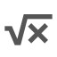
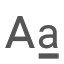
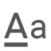

# Menubar

The menubar is the grey toolbar at the top of an open editor. It is made of
two rows of buttons and a breadcrumb below them. Some controls are only shown
when the current configuration, project, selection, or editor state makes them
available. A disabled button cannot perform its operation for the current
selection. Hover a button to see its description and, where applicable, its
keyboard shortcut.

## Desktop application menu

The installed desktop application also has the operating-system application
menu. Its contents are independent of the two-row editor toolbar.

### File

- **Open** opens a document (`Ctrl/Cmd+O`).
- **Open recent... > document...** lists recently opened documents. Choosing one
  opens it with the configuration with which it was recorded.
- **Open recent... > project...** lists recently opened projects. Choosing one
  opens the project.
- **Save** saves the current document (`Ctrl/Cmd+S`).
- **Save as** saves the document to a new location or format
  (`Ctrl/Cmd+Shift+S`).
- **Import** imports a document through Pandoc.
- **Export** exports the current document.
- **New/Edit project** creates a new project or edits the current project.
- **Update static resources** updates the application's user-level static
  resources.
- **Upload configurations** opens a file picker, loads editor configurations,
  and refreshes the editor.
- **Download configurations** saves the available configurations to a file.
- **Exit** closes the application.

### View

- **Reset zoom** restores the default zoom.
- **Zoom in** and **Zoom out** change the application zoom. The desktop menu
  displays `Ctrl/Cmd+=` for zoom in.
- **Toggle fullscreen** enters or leaves fullscreen mode.

### Tools

- **Toggle Spell Checker** turns the editor spell checker on or off.
- **Toggle Developer Tools** opens or closes Chromium Developer Tools
  (`Ctrl/Cmd+Shift+I`). The item is checked while Developer Tools are enabled.

## First toolbar row

###  New document

The document icon creates an empty document. If more than one configuration is
available, the split button has two behaviors:

- clicking the main button creates the document with the default configuration;
- clicking the arrow opens a list of configurations. Choosing a configuration
  creates the document with that configuration.

If only one configuration is available, the arrow is not shown.

###  Open document

Click the main part to open a document using the file chooser. The arrow opens
a menu that is populated when it is opened:

- **Recent projects** opens a submenu of recent projects. It is disabled when
  there are none.
- **Recent documents** opens a submenu of recent documents. It is disabled
  when there are no recent documents and no current document.
- **Reload current document** appears at the top of the recent-document submenu
  when a document is open and reads the file again.
- When a project is open, entries can open the next or previous project
  document, the parent project document, or the only contained child document.
  If there are several child documents, **Open contained project document**
  opens a second submenu listing them.

Selecting a recent or project document closes the menus and opens the selected
document. Recent-document entries retain their document configuration.

###  Save

The save control is a split button. Its main action is **Save** in compact
mode and **Save a copy** in expanded mode. The arrow menu contains:

-  **Save**
-  **Save as**
-  **Save a copy**
- **Expand** or **Compact**, which changes whether Save and Save as are shown
  as separate buttons beside the split button.

The button color indicates unsaved changes or a document that has only been
saved/exported as a copy. Save dialogs ask for the destination and document
format; canceling them leaves the document unchanged.

###  Render output

This control is present when the configuration provides output converters. The
main button renders the last selected target, or opens the target menu when no
target has been selected. While rendering, it shows a progress indicator.

The arrow menu contains **Current and recent renderings**, followed by the
configured converters and their result paths. A converter may have a submenu
when it can render the current document or one of its containing project
documents. A target currently being rendered is disabled. Selecting a target
starts rendering and closes the menu.

**Current and recent renderings** opens a dialog showing active and recent
renderings, their feedback, and a **Stop** action for active jobs. The dialog
can be closed without stopping a job.

###  Include document

The add-document button opens the document import chooser. It starts in the
current include or working folder and uses the current include or working
format as its initial format. After a file is chosen, its converted contents
are appended to the current document. Canceling the chooser does nothing.

###  Undo, redo, and repeat

-  **Undo** undoes the last edit and updates index references where necessary.
-  **Redo** reapplies an undone edit.
-  **Repeat command** repeats the last repeatable editor command. It is disabled
  when there is no repeatable command; its tooltip describes the command that
  will be repeated.

### Block movement, paragraph, and wrappers

-  **Move or swap blocks** is a toggle. When enabled, the block-movement
  commands move or swap blocks vertically; its tooltip shows the current state
  and the movement shortcuts.
-  **Toggle plain paragraph** converts the selected block to or from a plain
  paragraph.
-  **div** wraps the selection in a `Div`, or unwraps it with the adjacent
   **unwrap** button. If custom styles are configured for `div`, the arrow opens a
  list of classes; choosing one wraps the selection with that class.
-  **figure** behaves the same way for a `Figure`. Its adjacent  **unwrap** button
  removes the figure wrapper. When the cursor is inside a figure, the
   **caption** button wraps the relevant content in a figure caption.

Wrapper controls are disabled when the current selection cannot be wrapped or
unwrapped. Choosing a custom class closes its popup and applies the class.

### Block types and lists

-  **Block quote** toggles a block quote.
-  **Bullet list** toggles a bulleted list.
-  **Ordered list** toggles a numbered list.

These buttons are disabled when the corresponding operation is not valid for
the current selection.

###  Image

Click the image button to insert a new image at the cursor. The arrow menu
contains:

- **Fix absolute src** makes image sources relative in the selection.
- **Fix all absolute src** makes image sources relative throughout the document.

###  Notes

The note button inserts a new note of the configured default note type.
Its arrow opens the note menu. Each configured note type has:

- a button to insert a note of that type;
- **Expand all** notes of that type;
- **Close all** notes of that type.

The **all notes** row refreshes/fixes note numbers and can expand or close all
notes regardless of type. The menu closes after an action.

###  Table tools

The table button opens a movable, non-modal table-tools dialog. The header
contains buttons to move it to the top, bottom, left, or right, toggles for
the groups listed below, and a close button. Turning a group off hides that
group without changing the table.

- **Table**: create a table, convert text to a table, convert a table to text,
  delete the current table, check and fix a Pandoc table, maximize table width,
  equalize column widths, and add or remove a caption.
- **Body headers**: increase or decrease header rows and header columns.
- **Sections**: add or make a table head, add or make table bodies before or
  after the current body, add or make a foot, and remove the current section.
- **Rows and columns**: add or remove rows and add or remove columns before or
  after the current position.
- **Column alignments**: use default, left, center, or right alignment.
- **Cell alignment**: use default, left, center, or right horizontal
  alignment, and baseline, top, middle, or bottom vertical alignment.
- **Cells**: decrease or increase column span, decrease or increase row span,
  merge cells, or split a cell.

Operations that do not apply to the current table or selection are disabled.
Text/table conversion opens a small dialog with a separator field, a menu of
predefined separators, and (for text-to-table) a regular-expression toggle.
**Convert** performs the conversion; **Cancel** closes the dialog.

###  Horizontal rule

**Horizontal rule** inserts a horizontal rule at the cursor. It is disabled
when the current document position cannot contain one.

###  Project controls

When a project is open, **Project structure** opens a dialog showing the
project tree. Selecting a document in that dialog opens it; the dialog can
also create a sub-editor where supported.

The  project menu arrow contains:

- **Edit configuration** opens the project editor configuration dialog.
- **Manage changes** opens the Git changes dialog.
- **Check updates** opens the Git updates dialog.
- **Share** opens the repository dialog in publish mode.
- **Connect** opens it in connect mode.
- **Clone** opens it in clone mode.

Each project dialog has its own cancel/close controls. The Git changes and Git
updates dialogs can switch to each other; merging updates reloads the project.
When no project is open, the project control is a direct  **Clone** button and
opens the repository dialog in clone mode.

In development builds a **debug** button may appear at the far right. It opens
the current document state information. The application version may also be
shown there.

## Second toolbar row

###  Marks and text transformations

-  **Clear all marks/styles** removes all marks from the selection.
-  **Emphasis**,  **strong**,  **underline**,  **strikeout**,  **superscript**,
   **subscript**,  **small caps**,  **single quotes**,  **double quotes**,
   **code**,  **link**,  **citation**, and  **math** toggle the corresponding
  inline mark. Active marks are highlighted. A mark button applies to the
  selection or affects text typed at the cursor, depending on the selection.

-  **Lower case**,  **upper case**, and  **Uppercase first** transform the
  selected text. These commands are repeatable.

### Raw inline and block content

 **Raw inline** opens a popup with tabs for the configured formats and their
sample raw contents. With a selection, the **all** tab can convert selected
RawInlines to text or make the selection a RawInline of a chosen format.
Format tabs insert a configured sample. Frequently used samples are ordered
first when sorting is enabled.

 **Raw block** opens a similar popup. Its **all** tab can convert selected
RawBlocks to text or turn the selection into a RawBlock of a chosen format.
Other tabs insert configured samples. The popup closes after inserting a
sample.

###  Index references

The index buttons insert a reference to each configured document index. The
button title identifies the index; active references are highlighted and an
invalid insertion is disabled.

###  Search and whole-document transformations

 **Search and replace** opens the search-and-replace dialog. It remains open
until its close control is used and supports the document search and replace
operations.

 **Whole-document transformation** opens a menu of configured Pandoc-filter
transformations. Each item shows its configured name and description. Choosing
one starts the transformation. If a transformation is already running,
clicking the main button opens its progress dialog instead. That dialog shows
the log and failure state and provides **Cancel transformation**; closing it
does not silently mark a failed transformation as successful.

###  Markdown editor

 **Edit this document as Markdown** opens a full-screen CodeMirror dialog. The
document is converted to Markdown when the dialog opens. Edit the Markdown
directly, then choose **ok** to convert it back to the editor document or
**cancel** to discard the edits. The dialog cannot be dismissed with Escape;
use one of its buttons.

###  Unicode character table

 **Insert Unicode character** opens the character dialog. Choose a Unicode
block or category, or type at least three characters in **search** to filter
the available characters. The upper table shows stored/search results and the
lower area shows the current selection. Click a character to insert it at the
cursor.

The lower area can be displayed as a table or list with the view toggle. The
close button (or Escape) closes the dialog without inserting anything.

###  Configuration and status

The configuration selector is shown when more than one configuration is
available. Its label is the current project name or configuration name. The
arrow lists the other configurations; selecting one reloads the document with
that configuration.

The configuration selector does not itself edit configuration settings; use
the project menu's **Edit configuration** entry for that.

The editor key may be shown at the far right when enabled by the GUI
configuration. The breadcrumb below the rows shows the current node and mark
context; clicking its edit control opens the attributes editor for the
selected node or mark. The attributes editor provides tabs for applicable
attributes and **Change**/**Cancel** actions.
