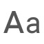
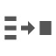

# Search and replace

The **Search and replace** dialog searches the current document and can replace
the selected result or all results. Open it from the menubar search button or
with `Ctrl/Cmd+F`. The dialog is seamless: it stays over the editor, can be
moved to the top, bottom, or right, and does not prevent editing when you click
back in the document.

The dialog supports two modes:

- **Text search** finds text literally or with a regular expression.
- **CSS selector search** selects document nodes and marks by a CSS-like
  selector.

The current result count is shown in the search chip at the top. Before a search
it prompts you to start searching. After a search it shows the number of results
and, when one is selected, its position in the result list. The chip is positive
when results exist and negative when there are none. Hover it for the full count
and query.

## Dialog header

 The result chip identifies the
current result and its count.

 **Reset** clears the search text,
replacement text, search-only mode, text-search options, and configured actions.
It does not close the dialog.

 **Save settings** opens a popup for
storing the current search. Select a project or editor configuration, enter a
name and optional description, then choose **Save**. If the name already exists,
the button changes to **Update**. **Delete** removes the existing setting with
that name. **Cancel** closes the popup without saving. The save button is
disabled until a valid destination and non-empty name are selected.

 **Just search, don't
replace** hides the replacement field and changes replacement actions into
actions on found items. Turn it off to enable text replacement.

 **CSS selectors**
switches between text search and CSS selector search. Switching modes preserves
the input for each mode and immediately applies the new mode's query.

 In text mode, **Load search
settings** opens a menu of predefined or saved search-and-replace settings. In
CSS mode, it opens a menu of predefined or saved CSS selector settings. Each
menu item shows its name; hover it for its description. Selecting an item loads
its options and starts the corresponding search.

 **Show index buttons** is
available when the configuration defines indices. It adds buttons for inserting
an index reference into the current found selection. The buttons use the
configured index names, icons, and colors.

 **Show more/less
fields** collapses or expands the query, options, and replacement controls. The
result and action buttons remain available when the fields are collapsed.

 **Close** hides all search
highlights, restores normal editor focus, and closes the dialog. Pressing Escape
while the query field has focus does the same.

The dialog can be repositioned with the arrow buttons. The button for the
current position is omitted.

## Query fields

### Text search

In text mode the first field is labeled **Search text**, or **Search regular
expression** when regular-expression mode is enabled. Enter a query and click
 **Search**, or press Enter in the
field. When the dialog opens with a non-empty editor selection, that selected
text is copied into the search field.

The search scans the document and highlights every matching range. The active
range is selected in the editor. Editing the query clears the current result
state; search again to rebuild the matches.

 **Case insensitive
search** ignores letter case. It is off by default.

 **Regular expression**
interprets the query as a Unicode-aware regular expression instead of literal
text. Invalid or empty queries produce no valid matches. In a replacement,
regular-expression capture groups can be referenced with `$1`, `$2`, and similar
placeholders; `$&` represents the complete match.

 **Whole words** excludes a
match when a word character touches either side of it.

 **Cycle through found texts**
wraps navigation from the last result to the first and from the first to the
last. When it is off, navigation stops at either end.

 **Filter searched text styles**
adds a marks palette. Each mark or custom style can be in one of three states:

- neutral: do not filter by this mark or style;
- positive: the match must have it;
- negative: the match must not have it.

The filter is applied in addition to the text query. The palette label shows the
active filters, using `+name` for required and `-name` for excluded styles.

### CSS selector search

In CSS mode the field is labeled **CSS selector(s)**. Enter a selector and click
**Search**. CSS search selects nodes and marks rather than finding characters
inside their text. Results are ordered in document order and the current node or
mark is selected and scrolled into view.

Selectors are case-insensitive for type names and may use internal ProseMirror
names or matching Pandoc names. Common aliases include `p`/`para`, `header`,
`h1` through `h6`, `hr`, `br`, `linebreak`, `softbreak`, `em`, `dq`, `sq`, and
`quoted`. Attribute selectors and the supported CSS combinators (descendant,
child, adjacent sibling, and general sibling) can be used to narrow the
selection. For example, `Quoted[quoteType=DoubleQuoted]` selects double-quoted
text.

 **Merge adjacent text ranges
with the same marks** combines adjacent matching marked text into one result. It
is enabled by default and is the only query option specific to CSS mode.

Predefined CSS settings can also specify replacement text, search-only mode, the
merge option, and actions. Selecting one loads those values and runs the
selector.

## Search history

 The history button appears in the
query field after searches have been recorded. It lists up to 20 unique recent
searches, including the query, replacement or actions, and icons for options
such as search-only, cycling, case-insensitive, regular-expression, whole-word,
or merged-mark searches. A CSS entry is marked as CSS.

Selecting a history entry restores its mode, query, replacement, options, mark
filters, and actions. It does not start searching until **Search** is pressed.

## Selecting results

 **Select previous** and
 **Select next** move the active
selection through the results. They are disabled when there is no result in that
direction, unless cycling is enabled. Text results are selected in the editor;
CSS results select the matching node or mark and scroll it into view.

The same navigation is available from the keyboard:

- `Alt+Left` selects the previous result.
- `Alt+Right` selects the next result.
- `Shift+Alt+Right` replaces the current result and selects the next one.

These shortcuts also work when the dialog is not the active control, as long as
the editor has focus.

## Replacement

When search-only mode is off, the **Replace with** field appears below the
query. The replacement text is applied to the active result and preserves the
editor's applicable marks. An empty replacement deletes the matched text.

 **Replace selected**
replaces only the active result.

 **Replace and select next** replaces the
active result, then selects the next result. It does nothing after the last
result unless cycling is enabled.

  **Replace all** processes every result.
With cycling enabled it still stops after one complete pass; it does not replace
the same result indefinitely.

In CSS mode, replacement acts on the current selected node or mark. `$&` in the
replacement is replaced with the current selected content. Without `$&`, the
selection is replaced by the entered text; an empty replacement removes the
selected content where possible.

## Actions on found or replaced items

 The **Actions on found items**
dropdown is shown in search-only mode. The **Actions on replaced items**
dropdown is shown when replacement is enabled. Actions run in the order
displayed after the found item is selected or after its text is replaced.

Open the dropdown to edit its action list:

- **Append new** adds an action.
- Each action has a numbered position. Use the up/down arrows to reorder it and
  the delete icon to remove it.
- The action name opens a menu for replacing it with another action.
- The editor at the right supplies the action's parameters, such as a mark,
  style, class, attribute, node type, index, raw-inline format, or span
  attributes.
- **Close** closes the action editor and keeps the current list.

Available actions include:

- add, remove, or rename a class;
- add, remove, or rename an attribute;
- add or remove a mark;
- add or remove a custom style;
- add or remove a custom class and its attributes;
- add a `Span` with classes and/or attributes;
- convert a node such as a paragraph or header;
- set an index reference at the selection;
- insert a RawInline before, after, or around the selection;
- convert text to lower case, upper case, or uppercase-first;
- delete the current CSS-selected node or mark; and
- unwrap the current CSS-selected node or remove its mark.

Actions that are not valid for the current result are ignored by the editor's
normal command checks. In CSS search, actions can operate on the selected node
or mark even when no replacement text is specified.

## Result actions in CSS mode

CSS results can be nodes, text nodes, or marks. Selecting a result changes the
editor selection to that element, so the replacement and action controls operate
on the item currently shown by the result counter. For example:

- replacing a selected text node changes its text;
- replacing a selected block node replaces its contents according to the
  editor's node rules;
- applying a mark or custom style changes the selected range; and
- deleting or unwrapping acts on the selected node or mark.

After a document edit, surviving CSS selections are mapped to their new
positions; selections deleted by the edit are removed.

## Saved and predefined settings

Text search settings are supplied by the editor configuration as
`search-replace` automations. CSS settings are supplied as `elements-selection`
automations. A saved setting can target the current project or a specific editor
configuration. Loading one restores its description, query, options, filters,
replacement, and actions as supported by that automation.
